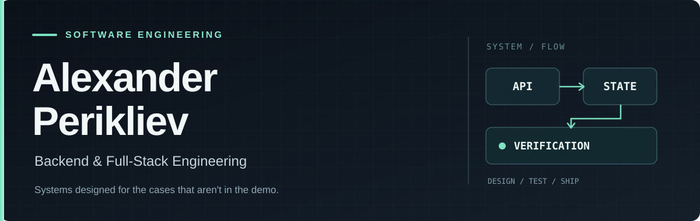

  

# I build software that holds up under pressure.

I work on backend-heavy products where **data integrity, concurrency, permissions, and reliable delivery** matter. The interesting problems usually show up when two requests happen at once, a workflow gets interrupted, or an assumption stops being true.

I use AI agents extensively for implementation and independent reviews. **Generated code isn't proof that something works.** Tests, database constraints, and observable behavior are.

---

## Technology stack

### Backend &amp; data

  &nbsp;&nbsp;&nbsp;
  &nbsp;&nbsp;&nbsp;
  &nbsp;&nbsp;&nbsp;
  &nbsp;&nbsp;&nbsp;
  &nbsp;&nbsp;&nbsp;
  &nbsp;&nbsp;&nbsp;
  &nbsp;&nbsp;&nbsp;

**Node.js** · **TypeScript** · **JavaScript** · **Express** · **PostgreSQL** · **Prisma** · **MongoDB**

### Frontend

  &nbsp;&nbsp;&nbsp;
  &nbsp;&nbsp;&nbsp;
  &nbsp;&nbsp;&nbsp;
  &nbsp;&nbsp;&nbsp;

**React** · **HTML5** · **CSS3** · **Tailwind CSS**

### Linux, infrastructure &amp; delivery

  &nbsp;&nbsp;&nbsp;
  &nbsp;&nbsp;&nbsp;
  &nbsp;&nbsp;&nbsp;
  &nbsp;&nbsp;&nbsp;
  &nbsp;&nbsp;&nbsp;
  &nbsp;&nbsp;&nbsp;

**Linux** · **Ubuntu** · **Docker** · **Nginx** · **Git** · **GitHub Actions** · **AWS**

---

## How I engineer

**01 / Make the rules explicit.** Define what must always hold true, including the edge cases that aren't obvious from a happy-path demo.

**02 / Check the difficult paths.** Concurrency, access control, transactions, state transitions, and failure recovery deserve more attention than the easy scenarios.

**03 / Verify independently.** Use automated tests, review, and direct inspection of system behavior. An AI agent's confidence is not a test result.

**04 / Ship responsibly.** CI/CD, deployment, migrations, backups, and operational visibility are part of the system, not work to leave for later.

---

**Based in Bulgaria** · Open to backend and full-stack software engineering opportunities
